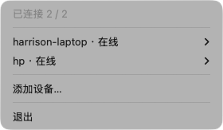
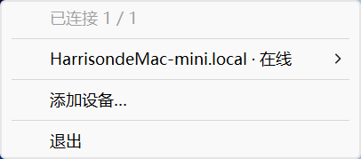
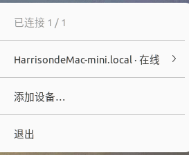
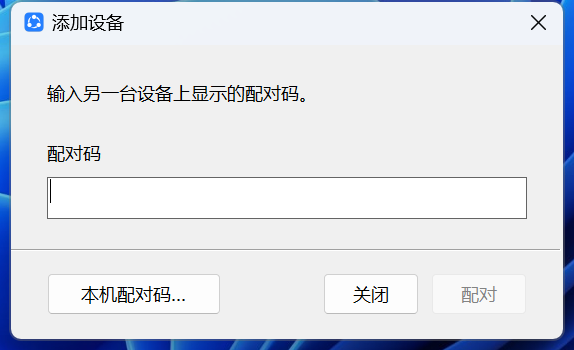
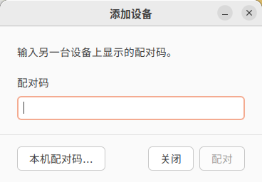
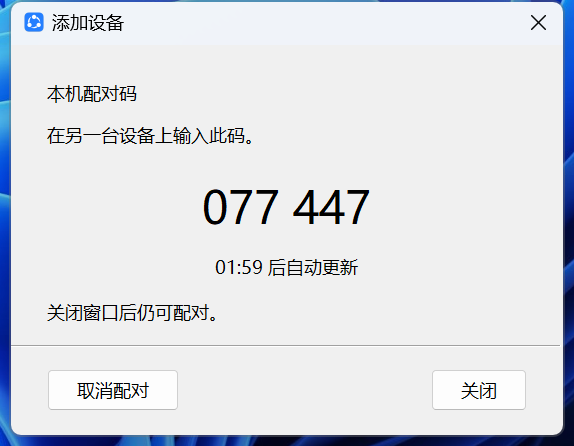

# clipx

在一台电脑复制，在另一台电脑粘贴。

clipx 让 macOS、Windows 和 Linux 电脑共享剪贴板，支持文本、图片、文件和文件夹。设备在局域网内直接连接，传输经过加密，无需账号或云端服务器。配对后，保持 clipx 运行即可自动同步。

日常使用推荐桌面版，常驻菜单栏或系统托盘；也可以使用 CLI。两者可以互相配对。

## 安装

### macOS

使用 [Homebrew](https://brew.sh/) 安装：

```sh
brew install --cask harrisonwang/tap/clipx-gui  # 桌面版
brew install harrisonwang/tap/clipx             # CLI
```

桌面版从「应用程序」打开。首次运行时，请允许 clipx 访问本地网络。

### Windows

使用 [Scoop](https://scoop.sh/) 安装，包含桌面版、CLI 和开始菜单快捷方式：

```powershell
scoop bucket add harrisonwang https://github.com/harrisonwang/scoop-bucket
scoop install clipx
```

从开始菜单打开 clipx。也可以下载便携 EXE，直接运行。

### Linux

桌面版一键安装（x86_64）：

```sh
curl -fsSL https://raw.githubusercontent.com/harrisonwang/clipx/main/scripts/install-linux.sh | bash
```

脚本校验下载文件，并将应用和图标安装到当前用户的应用菜单，无需 `sudo`。再次运行即可更新。GNOME 桌面需要启用 AppIndicator 扩展，以显示托盘图标。

CLI 使用 [Homebrew](https://brew.sh/) 安装：

```sh
brew install harrisonwang/tap/clipx
```

所有平台也可从 [GitHub Releases](https://github.com/harrisonwang/clipx/releases/latest) 下载：macOS 为 DMG，Windows 为便携 EXE，Linux 为 AppImage。

## 桌面使用

1. 在两台电脑上打开 clipx，确保它们处于同一局域网。
2. 在第一台电脑的托盘菜单中选择「添加设备…」→「本机配对码…」。
3. 在另一台电脑选择「添加设备…」，输入这 6 位数字，再点击「配对」。
4. 配对成功后窗口自动关闭。托盘显示设备在线，即可跨电脑复制粘贴。

可以继续添加更多设备，已有连接会保持。每个配对码用于添加一台设备，有效期两分钟，过期自动更新。关窗会保留当前邀请，再次选择「添加设备…」可恢复查看；若要结束邀请，选择「取消配对」。

托盘菜单中可以查看连接状态、移除设备或退出。文件和文件夹可在 Finder、资源管理器或文件管理器中复制，再到另一台电脑粘贴。收到的内容会替换本机剪贴板，clipx 不保存剪贴板历史。

以下为当前开发版本的三端实机截图：

| | macOS | Windows | Linux（Ubuntu） |
| --- | --- | --- | --- |
| 托盘 |  |  |  |
| 添加设备 |  |  |  |
| 本机配对码 |  |  |  |

## CLI 使用

首次配对，在两台电脑上分别运行：

```sh
# 设备 A：显示配对码，等待连接
clipx

# 设备 B：输入 A 显示的配对码，保留开头的 0
clipx --pair 001234
```

配对成功后，两端自动开始同步。以后直接运行 `clipx` 即可，无需再次配对。按 `Ctrl+C` 退出。

```sh
clipx devices                 # 查看已配对设备
clipx forget <设备ID>          # 移除设备，先退出本机同步进程
clipx copy <文件或文件夹>...   # 放入本机剪贴板
clipx --tray                  # 启动已安装的桌面版
clipx --help                  # 更多选项
```

CLI 和桌面版任选其一运行；同一用户配置不能同时启动两个同步进程。Linux 的 CLI 同步也需要在可访问剪贴板的图形会话中运行。

## 连接问题

请先确认两端版本一致、clipx 正在运行，且网络允许设备互相访问。自动发现使用 UDP 5353，同步使用 TCP 45876（默认），目前需要 IPv4。macOS 请检查本地网络权限；使用访客 Wi-Fi 或开启设备隔离时，可能无法发现或连接对方。

多设备是分别配对、直接连接；如需任意两台电脑在其他设备离线后仍能同步，请将它们两两配对。

## 开发

需要 Rust stable。Ubuntu 构建桌面版需安装 `libgtk-3-dev` 和 `libayatana-appindicator3-dev`。

```sh
cargo build --locked --release --workspace
cargo fmt --all -- --check
cargo clippy --locked --workspace --all-targets -- -D warnings
cargo test --locked --workspace --all-targets
```

## 许可证

[MIT](LICENSE)
